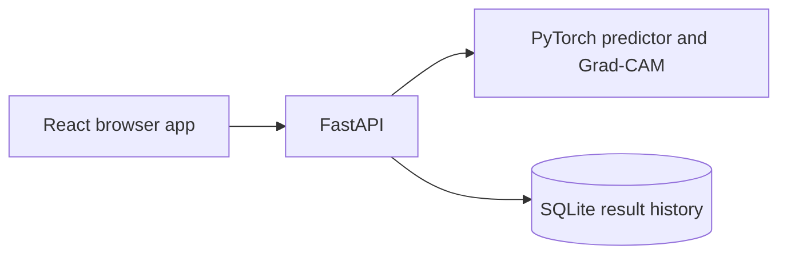

# TruthLens

TruthLens is an educational web service for estimating whether an image resembles real or AI-generated training examples. It returns a REAL/FAKE prediction, the model's confidence, and a Grad-CAM visualization. It is not a forensic tool: a score is not proof of authenticity or editing.

> **Model status:** the repository does not include trained weights or the CIFAKE dataset. Until a checkpoint is trained and installed at `ml/artifacts/best.pt`, the API starts in a safe model-not-loaded state and image analysis returns HTTP 503. No model performance numbers are claimed until `ml/evaluate.py` produces them.

## Architecture



In production, one Docker container serves the built React app and `/api/v1` from the same FastAPI process. Uploaded images are validated and processed in memory; history stores result metadata and a small thumbnail, not the original upload.

## Run locally

Requirements: Python 3.11+, Node.js 20+, and npm. Docker is optional for local development.

1. Copy `.env.example` to `.env` and adjust values if required.
2. Install the backend and ML dependencies in a virtual environment:

   ```powershell
   python -m venv .venv
   .\.venv\Scripts\python.exe -m pip install --upgrade pip
   .\.venv\Scripts\python.exe -m pip install torch torchvision --index-url https://download.pytorch.org/whl/cpu
   .\.venv\Scripts\python.exe -m pip install -r ml\requirements.txt -r backend\requirements.txt
   ```

3. In one terminal, start the API from the repository root:

   ```powershell
   .\.venv\Scripts\python.exe -m uvicorn backend.app.main:app --reload --port 8000
   ```

4. In another terminal, install and start the frontend:

   ```powershell
   cd frontend
   npm ci
   npm run dev
   ```

   Open the Vite URL (normally `http://localhost:5173`). Its `/api` proxy forwards to the API on port 8000.

The app and health endpoint work without model weights; uploads intentionally report `model_not_loaded` until a real checkpoint exists.

## Dataset and training

Download CIFAKE images using Kaggle credentials or manually. Keep them under `ml/data/cifake/` with training and test folders containing `REAL` and `FAKE` class directories. See [ml/data/README.md](ml/data/README.md) for both supported datasets and manual download locations. Never commit dataset images.

```powershell
python -m ml.train --dry-run --max-samples 200
python -m ml.train --arch mobilenet_v2 --max-samples 4000 --epochs 5
python -m ml.train --arch resnet50 --max-samples 4000 --epochs 5
python -m ml.evaluate --compare --max-samples 4000
```

`--dry-run` checks dataset discovery and tensor shape without training. Full training loads ImageNet pretrained weights, so it needs an internet connection the first time (or a cached torchvision checkpoint). Evaluation writes metrics and diagnostic plots in `ml/artifacts/`; the comparison winner is copied to `best.pt`. Large `.pt` files are tracked with Git LFS. Run `git lfs install` before adding a trained checkpoint.

### Train on Google Colab

If local disk, memory, or accelerator resources are insufficient, upload the `ml/` source to a Colab notebook, install `ml/requirements.txt` plus CPU- or CUDA-compatible PyTorch, and mount/upload the downloaded dataset under `ml/data/`. Run the same `python -m ml.train` commands for both architectures and `python -m ml.evaluate --compare`; download the generated `ml/artifacts/` files and place them in this repository. Only report evaluation figures generated from your actual dataset and checkpoint.

## API reference

All application routes are under `/api/v1`:

| Method | Path | Purpose |
|---|---|---|
| GET | `/health` | API and model readiness |
| POST | `/analyze` | Analyze one multipart image field named `file` |
| GET | `/history?limit=20` | Return recent results and thumbnails |
| DELETE | `/history/{id}` | Delete one history item |
| DELETE | `/history` | Clear the local history |

Supported images are JPEG, PNG, and WebP, up to 5 MB by default. Errors use `{"error":{"code":"...","message":"..."}}`. Interactive API documentation is available at `/docs`.

To check the live response contract with a local sample image and a loaded model:

```powershell
python scripts\check_contract.py --url http://localhost:8000 --image C:\path\to\sample.jpg
```

## Docker and Hugging Face Spaces

Build and run the single-container app locally:

```powershell
docker build -t truthlens .
docker run --rm -p 7860:7860 truthlens
```

Open `http://localhost:7860`. Docker requires a checkpoint for image analysis; without one the API explicitly reports the missing model. The container runs as a non-root user and installs CPU-only PyTorch.

To publish on Hugging Face Spaces, create a Space using the Docker SDK and push this repository to its Git remote. Add `ml/artifacts/best.pt` to the Space build context after training; Git LFS is configured for `.pt` checkpoints. Configure the Space to expose port 7860. A free-tier filesystem may be ephemeral, so local history can reset on restart.

## Evaluation results

No evaluation results are checked in yet. The model metrics page will populate from `frontend/src/data/metrics.json` after a real training and evaluation run.

## Limitations and responsible use

- The classifier can fail on generators, edits, image sizes, or compression levels absent from training.
- CIFAKE images are relatively low resolution; face-only datasets can create content and population bias.
- Confidence is not calibrated proof. Use independent evidence and human review; never use a result alone to accuse or make a consequential decision about a person.
- Grad-CAM highlights regions that influence the model. It does not establish that a highlighted region was manipulated.
- Images are processed in memory. The SQLite history retains a 96px thumbnail and prediction metadata, not the original image.

## Credits

- CIFAKE: [Real and AI-Generated Synthetic Images](https://www.kaggle.com/datasets/birdy654/cifake-real-and-ai-generated-synthetic-images)
- Design reference: [Linear design entry in awesome-design-md](https://github.com/VoltAgent/awesome-design-md/tree/main/design-md/linear.app)
